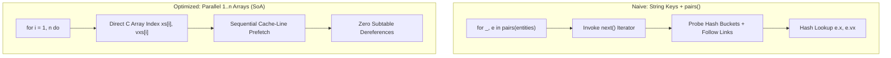

# Array vs Hash in Lua: Cache Locality and SoA

## Table of Contents

- [Introduction](#introduction)
- [Inside Lua's Hybrid Table Struct](#inside-luas-hybrid-table-struct)
- [CPU Cache Lines, AoS, and SoA](#cpu-cache-lines-aos-and-soa)
- [Naive vs. Array vs. SoA Walkthrough](#naive-vs-array-vs-soa-walkthrough)
  - [Naive: String-Keyed Hash Table](#naive-string-keyed-hash-table)
  - [Optimized 1: Contiguous `1..n` Array of Structs (AoS)](#optimized-1-contiguous-1n-array-of-structs-aos)
  - [Optimized 2: Structure of Arrays (SoA)](#optimized-2-structure-of-arrays-soa)
- [Pitfalls, Trade-offs, and When NOT to Use](#pitfalls-trade-offs-and-when-not-to-use)
- [Profiling Tips](#profiling-tips)
- [Summary](#summary)

---

## Introduction

Imagine checking 50,000 lockers. If they are numbered `1` through `50,000` down a single hallway, you walk straight ahead and open each door in stride. If they are labeled with random codes like `"e4129"` and scattered across different rooms, you spend most of your time consulting a directory and walking back and forth.

Lua tables look identical on the surface, yet their internal memory layout changes drastically depending on whether you index them with `1..n` integers or string keys.

---

## Inside Lua's Hybrid Table Struct

Every Lua `Table` C struct contains two separate storage regions:

1. **Array Part (`TValue *array`)**: A contiguous C array for dense integer keys `1..n`. Indexing `t[i]` is a single bounds check plus pointer arithmetic (`array[i - 1]`).
2. **Hash Part (`Node *node`)**: A chained scatter table for string keys, floats, booleans, or sparse integers. Iterating with `pairs(t)` calls Lua's `next()` function on every step to probe hash buckets and follow collision chains.

```text
Hash Table ("e1", "e2")        Contiguous Array (AoS)       Parallel Arrays (SoA)
+-----------------------+      +----------------------+       xs: [ f1 | f2 | f3 | ... ]
| Node["e42"] -> {e}    |      | [1] -> {x,y,vx,vy}   |       ys: [ y1 | y2 | y3 | ... ]
| Node["e1"]  -> {e}    |      | [2] -> {x,y,vx,vy}   |      vxs: [ 1.5| 1.5| 1.5| ... ]
| (unordered + next())  |      | [3] -> {x,y,vx,vy}   |      vys: [-0.5|-0.5|-0.5| ... ]
+-----------------------+      +----------------------+      (0 subtables, flat stride)
```



---

## CPU Cache Lines, AoS, and SoA

Modern CPUs fetch memory in 64-byte **cache lines**, not single bytes.
- In **AoS (Array of Structs)** (`entities[i] = { x = ..., y = ... }`), `entities[1..n]` is contiguous, but each element is a pointer to a separate heap-allocated subtable. Every iteration still chases a pointer and hashes `"x"`, `"vx"`, `"y"`, `"vy"`.
- In **SoA (Structure of Arrays)** (`xs`, `ys`, `vxs`, `vys`), all `x` values sit side-by-side in one flat `TValue` array. Sequential `for i = 1, n` loops stream smoothly through CPU cache lines with zero per-entity subtables.

---

## Naive vs. Array vs. SoA Walkthrough

### Naive: String-Keyed Hash Table

In `lessons/ArrayVsHash/naive.lua`, keys like `"e" .. i` force all 50,000 entries into the hash part:

```lua
for _, e in pairs(entities) do
    e.x = e.x + e.vx * dt
    e.y = e.y + e.vy * dt
end
```

### Optimized 1: Contiguous `1..n` Array of Structs (AoS)

In `lessons/ArrayVsHash/optimized.lua`, `update_array_aos` replaces `pairs()` with a numeric `for i = 1, n` loop over the array part, jumping from `0.1959 s` to `0.0370 s` (`5.30x` faster).

### Optimized 2: Structure of Arrays (SoA)

`create_soa` and `update_soa` eliminate the 50,000 entity subtables completely:

```lua
local xs, ys, vxs, vys = soa.xs, soa.ys, soa.vxs, soa.vys
for i = 1, n do
    xs[i] = xs[i] + vxs[i] * dt
    ys[i] = ys[i] + vys[i] * dt
end
```

Caching `soa.xs` in local registers before the loop drops median runtime to `0.0270 s` (`7.25x` faster than hash).

---

## Pitfalls, Trade-offs, and When NOT to Use

- **Sparse Arrays Break `#t`**: Leaving `nil` holes (`arr[3] = nil`) or inserting huge indices (`arr[100000] = 1`) moves keys into the hash part and makes `#arr` unreliable. Use swap-and-pop (`arr[i] = arr[n]; arr[n] = nil`) to keep arrays dense.
- **SoA Deletion Sync**: Removing entity `i` in SoA requires swap-and-pop across every parallel array (`xs`, `ys`, `vxs`, `vys`), which is easy to desync without a helper function.
- **When NOT to Use SoA**: If entities are heterogeneous (different components per entity), rarely iterated in bulk, or need frequent passing as self-contained objects across external APIs, AoS `1..n` arrays give you `5.30x` speedup with cleaner ergonomics.

---

## Profiling Tips

1. **Compare Memory Footprint**: Run `collectgarbage("count")` after `create_array_aos(50000)` vs `create_soa(50000)` to see the memory saved by removing 50,000 entity tables.
2. **Multi-Sample Harness**: Use `lessons/common/bench.lua` to measure median, min, and max times with isolated GC deltas.

---

## Summary

Workload: `50,000` entities updated over `20` frames (`1,000,000` updates) on `Lua 5.4.7` (`lessons/ArrayVsHash/Benchmark.md`).

| Layout | Median Time (Min / Max) | GC Delta | Speedup vs Hash |
|---|---|---|---|
| Hash (`pairs()` + string keys) | `0.1959 s` (`0.1792` / `0.2203`) | `0.06 KB` | `1.00x` |
| Contiguous `1..n` Array (`AoS`) | `0.0370 s` (`0.0362` / `0.0415`) | `0.00 KB` | **`5.30x` faster** |
| Parallel `1..n` Arrays (`SoA`) | `0.0270 s` (`0.0261` / `0.0333`) | `0.00 KB` | **`7.25x` faster** |
