```mermaid
flowchart TD
    classDef slow fill:#fee2e2,stroke:#dc2626,color:#111827
    classDef fast fill:#dcfce7,stroke:#16a34a,color:#111827
    classDef vm fill:#dbeafe,stroke:#2563eb,color:#111827
    classDef warn fill:#fef3c7,stroke:#d97706,color:#111827

    subgraph Hash["Ingênua: Chaves String + pairs()"]
        H1["for _, e in pairs(entities)"]:::slow --> H2["Chamar cursor next() a cada passo<br/>(sonda buckets espalhados)"]:::warn
        H2 --> H3["Salto de ponteiro para subtabela<br/>(endereço aleatório na RAM)"]:::slow
        H3 --> H4["Busca hash para e.x, e.vx<br/>(cache miss em cada entidade)"]:::slow
    end

    subgraph SoA["Otimizada: Arrays Paralelos 1..n (SoA)"]
        S1["for i = 1, n do"]:::vm --> S2["Offset direto xs[i], vxs[i]<br/>(array[i - 1] sem hash)"]:::vm
        S2 --> S3["Prefetch sequencial em cache de 64 B<br/>(CPU lê floats adjacentes)"]:::fast
        S3 --> S4["Zero indireções de subtabela<br/>(0.00 KB no GC, 7.25x mais rápido)"]:::fast
    end
```

# Array vs Hash em Lua: Localidade de Cache e SoA

## Sumário

- [Introdução](#introdução)
- [Por Dentro da Struct Híbrida `Table` em Lua](#por-dentro-da-struct-híbrida-table-em-lua)
- [Linhas de Cache da CPU, AoS e SoA](#linhas-de-cache-da-cpu-aos-e-soa)
- [Passo a Passo: Hash vs. Array vs. SoA](#passo-a-passo-hash-vs-array-vs-soa)
  - [Ingênua: Tabela Hash com Chaves String](#ingênua-tabela-hash-com-chaves-string)
  - [Otimizada 1: Array Contíguo `1..n` de Structs (AoS)](#otimizada-1-array-contíguo-1n-de-structs-aos)
  - [Otimizada 2: Structure of Arrays (SoA)](#otimizada-2-structure-of-arrays-soa)
- [Armadilhas, Trade-offs e Quando NÃO Usar](#armadilhas-trade-offs-e-quando-não-usar)
- [Dicas de Profiling](#dicas-de-profiling)
- [Resumo](#resumo)

---

## Introdução

Imagine conferir 50.000 armários. Se eles estão numerados de `1` a `50.000` em um único corredor reto, você caminha em linha reta abrindo cada porta em sequência. Se estiverem etiquetados com códigos aleatórios como `"e4129"` e espalhados por salas diferentes, você perde quase todo o tempo consultando o catálogo e andando de um lado para o outro.

Tabelas em Lua parecem idênticas na sintaxe, mas seu layout interno de memória muda radicalmente conforme você usa índices inteiros `1..n` ou chaves string.

---

## Por Dentro da Struct Híbrida `Table` em Lua

Toda `Table` em Lua possui duas áreas de armazenamento separadas em C:

1. **Parte de Array (`TValue *array`)**: Um array C contíguo de slots de valores para chaves inteiras densas `1..n`. Indexar `t[i]` faz apenas uma checagem de limite e aritmética direta de ponteiro (`array[i - 1]`) — sem calcular hash.
2. **Parte Hash (`Node *node`)**: Uma tabela de espalhamento encadeada (buckets de hash ligados em caso de colisão) para strings, floats, booleanos ou inteiros esparsos. Iterar com `pairs(t)` chama a função interna de cursor `next()` a cada passo para sondar buckets e seguir cadeias de colisão em ordem arbitrária.

```text
Tabela Hash ("e1", "e2")       Array Contíguo (AoS)           Arrays Paralelos (SoA)
+-----------------------+      +----------------------+       xs: [ f1 | f2 | f3 | ... ]
| Node["e42"] -> {e}    |      | [1] -> {x,y,vx,vy}   |       ys: [ y1 | y2 | y3 | ... ]
| Node["e1"]  -> {e}    |      | [2] -> {x,y,vx,vy}   |      vxs: [ 1.5| 1.5| 1.5| ... ]
| (sem ordem + next())  |      | [3] -> {x,y,vx,vy}   |      vys: [-0.5|-0.5|-0.5| ... ]
+-----------------------+      +----------------------+      (0 subtabelas, passo linear)
```



---

## Linhas de Cache da CPU, AoS e SoA

CPUs modernas buscam memória em **linhas de cache** de 64 bytes, não byte a byte.
- Em **AoS (Array of Structs)** (`entities[i] = { x = ..., y = ... }`), `entities[1..n]` é contíguo, mas cada slot guarda um ponteiro para uma subtabela separada na heap. Cada iteração ainda segue um ponteiro e calcula hash para `"x"`, `"vx"`, `"y"`, `"vy"`.
- Em **SoA (Structure of Arrays)** (`xs`, `ys`, `vxs`, `vys`), todos os valores `x` ficam lado a lado em um único array `TValue`. Loops `for i = 1, n` percorrem as linhas de cache sequencialmente sem nenhuma subtabela por entidade.

---

## Passo a Passo: Hash vs. Array vs. SoA

### Ingênua: Tabela Hash com Chaves String

Em `lessons/ArrayVsHash/naive.lua`, chaves como `"e" .. i` jogam todas as 50.000 entradas na parte hash:

```lua
for _, e in pairs(entities) do
    e.x = e.x + e.vx * dt
    e.y = e.y + e.vy * dt
end
```

### Otimizada 1: Array Contíguo `1..n` de Structs (AoS)

Em `lessons/ArrayVsHash/optimized.lua`, `update_array_aos` troca `pairs()` por `for i = 1, n` na parte de array, caindo de `0.1959 s` para `0.0370 s` (`5.30x` mais rápido).

### Otimizada 2: Structure of Arrays (SoA)

`create_soa` e `update_soa` eliminam completamente as 50.000 subtabelas de entidade:

```lua
local xs, ys, vxs, vys = soa.xs, soa.ys, soa.vxs, soa.vys
for i = 1, n do
    xs[i] = xs[i] + vxs[i] * dt
    ys[i] = ys[i] + vys[i] * dt
end
```

Guardar `soa.xs` em registradores locais antes do loop reduz o tempo mediano para `0.0270 s` (`7.25x` mais rápido que hash).

---

## Armadilhas, Trade-offs e Quando NÃO Usar

- **Arrays Esparsos Quebram `#t`**: Deixar buracos `nil` (`arr[3] = nil`) ou inserir índices gigantes (`arr[100000] = 1`) move chaves para a parte hash e torna `#arr` impreciso. Use swap-and-pop (`arr[i] = arr[n]; arr[n] = nil`) para manter o array denso.
- **Sincronia de Remoção em SoA**: Remover a entidade `i` em SoA exige aplicar swap-and-pop em todos os arrays paralelos (`xs`, `ys`, `vxs`, `vys`) juntos, fácil de dessincronizar sem uma função auxiliar.
- **Quando NÃO Usar SoA**: Se as entidades forem heterogêneas (campos opcionais distintos) ou passadas com frequência como objetos completos entre APIs externas, arrays `1..n` em AoS já entregam `5.30x` de ganho com ergonomia superior.

---

## Dicas de Profiling

1. **Compare o Consumo de Memória**: Rode `collectgarbage("count")` após `create_array_aos(50000)` vs `create_soa(50000)` para medir a economia ao remover 50.000 tabelas de entidade.
2. **Harness Multi-Amostra**: Use `lessons/common/bench.lua` para medir mediana, mínimo e máximo com deltas de GC isolados.

---

## Resumo

Carga: `50.000` entidades atualizadas por `20` frames (`1.000.000` de atualizações) no `Lua 5.4.7` (`lessons/ArrayVsHash/Benchmark.md`).

| Layout | Tempo Mediano (Mín / Máx) | Delta GC | Speedup vs Hash |
|---|---|---|---|
| Hash (`pairs()` + chaves string) | `0.1959 s` (`0.1792` / `0.2203`) | `0.06 KB` | `1.00x` |
| Array Contíguo `1..n` (`AoS`) | `0.0370 s` (`0.0362` / `0.0415`) | `0.00 KB` | **`5.30x` mais rápido** |
| Arrays Paralelos `1..n` (`SoA`) | `0.0270 s` (`0.0261` / `0.0333`) | `0.00 KB` | **`7.25x` mais rápido** |
