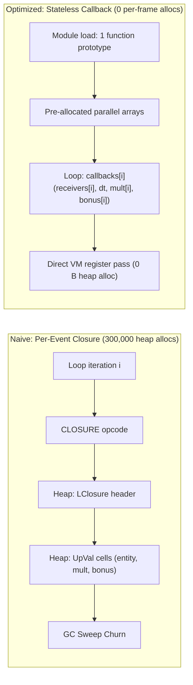

# Closure Reuse & Stateless Callbacks in Lua

## Table of Contents

- [Introduction](#introduction)
- [What Actually Happens Under the Hood?](#what-actually-happens-under-the-hood)
- [Step-by-Step Code Walkthrough](#step-by-step-code-walkthrough)
  - [The Naive Approach: Per-Event Closures](#the-naive-approach-per-event-closures)
  - [The Optimized Approach: Stateless Callbacks + Context](#the-optimized-approach-stateless-callbacks--context)
- [Benchmark Results](#benchmark-results)
- [Common Pitfalls & When NOT to Use This](#common-pitfalls--when-not-to-use-this)
- [How to Diagnose Closure Churn](#how-to-diagnose-closure-churn)
- [Summary Comparison](#summary-comparison)

---

## Introduction

Inline anonymous functions are one of Lua's most ergonomic features:

```lua
queue[i] = function(step_dt)
    entity.hp = entity.hp - damage * step_dt
end
```

Outside of hot loops, this style is clean and idiomatic. Inside a 60 FPS game loop handling thousands of timers, collision callbacks, tweens, or combat events per frame, however, evaluating `function(...) ... end` inside a loop forces the Lua VM to allocate a brand-new closure object on the heap every single time.

This lesson compares per-event closure creation against a single module-level stateless `local function` paired with explicit receiver/context arguments across **10,000 events over 30 frames (300,000 dispatches)**.

---

## What Actually Happens Under the Hood?

In Lua, a function definition is an executable statement (`CLOSURE` bytecode instruction in Lua 5.4; `FNEW` in LuaJIT). When a `function` literal captures local variables (`entity`, `multiplier`, `bonus`), those variables become **upvalues**.



Two important costs happen in the naive version:

1. **Heap Allocation of `LClosure`:** Each evaluation allocates a new `LClosure` GC object (`32+` bytes) plus `UpVal` wrappers (`~32` bytes per captured local) when variables escape the stack frame.
2. **LuaJIT Trace Aborts:** In LuaJIT, `FNEW` with escaping upvalues frequently aborts JIT compilation or forces allocations onto the GC heap, preventing register-only execution.

When we hoist the callback to a module-level `local function apply_impulse(entity, step_dt, multiplier, bonus)` that captures **zero** mutable locals, Lua creates that function object **once** at module load time.

---

## Step-by-Step Code Walkthrough

### The Naive Approach: Per-Event Closures

In [naive.lua](../naive.lua), every frame re-populates `queue[i]` with a fresh anonymous closure capturing `entity`, `multiplier`, and `bonus`:

```lua
for i = 1, count do
    local entity = entities[i]
    local multiplier = 1.0 + ((i % 5) * 0.1)
    local bonus = (i % 7) * 0.25
    queue[i] = function(step_dt)
        entity.vx = entity.vx + (bonus * step_dt)
        entity.vy = entity.vy + (multiplier * step_dt)
        entity.hp = entity.hp - ((multiplier + bonus) * step_dt)
        entity.hits = entity.hits + 1
    end
end
```

Even though the logic inside the function never changes, Lua must allocate 10,000 new closures and 30,000 upvalue bindings per frame.

### The Optimized Approach: Stateless Callbacks + Context

In [optimized.lua](../optimized.lua), the callback is declared once at module scope and takes all state explicitly via parameters:

```lua
local function apply_impulse(entity, step_dt, multiplier, bonus)
    entity.vx = entity.vx + (bonus * step_dt)
    entity.vy = entity.vy + (multiplier * step_dt)
    entity.hp = entity.hp - ((multiplier + bonus) * step_dt)
    entity.hits = entity.hits + 1
end
```

During setup, we store the function reference and parallel context arrays (`receivers`, `multipliers`, `bonuses`). During the frame loop, dispatching executes pure VM register calls:

```lua
for _ = 1, frames do
    for i = 1, count do
        callbacks[i](receivers[i], dt, multipliers[i], bonuses[i])
    end
end
```

---

## Benchmark Results

Measured with Lua 5.4 (`lua lessons/ClosureReuse/benchmark.lua`) over 10,000 events x 30 frames (`300,000` dispatches):

| Approach | Time (s) | GC Alloc (KB) | Speedup | Checksum |
|---|---:|---:|---:|---:|
| Naive (per-event closure) | 0.2391 | 51,818.62 | 1.00x | 10810000.0000 |
| Optimized (stateless + ctx) | 0.0702 | 1,024.22 | 3.40x | 10810000.0000 |

- **3.40x faster** execution time.
- **98.0% reduction** in GC memory allocation (`51.8 MB` vs `1.02 MB` one-time setup, `0 KB` per frame).

---

## Common Pitfalls & When NOT to Use This

- **Do NOT optimize cold UI or initialization code:** One-off button click handlers or scene-load callbacks run once and are much clearer as inline closures.
- **Avoid building new context tables per event:** Replacing `function() ... end` with `{ entity = e, bonus = b }` still allocates a heap table per event. Use pre-allocated parallel arrays or pooled context tables.
- **Watch out for hidden captures inside stateless helpers:** If a module-level function references a mutable module-level variable that changes per call, it is no longer re-entrant. Keep per-event state in explicit parameters.

---

## How to Diagnose Closure Churn

1. **Measure GC delta with `collectgarbage("count")`:** Pause the collector around a single frame (`collectgarbage("stop")`) and check `mem_after - mem_before`. Any steady upward climb per frame points to allocation churn.
2. **Inspect bytecode with `luac -l`:** Look for `CLOSURE` instructions inside inner `FORLOOP` blocks. Moving the `CLOSURE` outside the loop eliminates the allocation.

---

## Summary Comparison

| Criterion | Per-Event Closure (`naive.lua`) | Stateless Callback + Context (`optimized.lua`) |
|---|---|---|
| Per-frame `CLOSURE` allocs | 10,000 / frame (`51.8 MB` / 30 frames) | **0 / frame** |
| Upvalue indirection | `GETUPVAL` / `SETUPVAL` heap cells | Direct VM register arguments |
| Execution speed | 0.2391 s | **0.0702 s (3.40x faster)** |
| Best suited for | Cold UI hooks, one-shot setup | High-frequency event buses, timers, collision callbacks |
