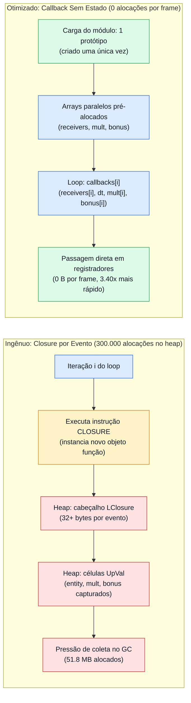

# Reutilização de Closures e Callbacks Sem Estado em Lua

## Índice

- [Introdução](#introdução)
- [O Que Realmente Acontece por Baixo dos Panos?](#o-que-realmente-acontece-por-baixo-dos-panos)
- [Passo a Passo do Código](#passo-a-passo-do-código)
  - [Abordagem Ingênua: Closures por Evento](#abordagem-ingênua-closures-por-evento)
  - [Abordagem Otimizada: Callbacks Sem Estado + Contexto](#abordagem-otimizada-callbacks-sem-estado--contexto)
- [Resultados do Benchmark](#resultados-do-benchmark)
- [Armadilhas Comuns e Quando NÃO Usar](#armadilhas-comuns-e-quando-não-usar)
- [Como Diagnosticar Pressão de Closures no GC](#como-diagnosticar-pressão-de-closures-no-gc)
- [Tabela Resumo Comparativa](#tabela-resumo-comparativa)

---

## Introdução

Funções anônimas inline são um dos recursos mais expressivos de Lua:

```lua
queue[i] = function(step_dt)
    entity.hp = entity.hp - damage * step_dt
end
```

Fora de loops críticos, esse padrão é limpo e idiomático. Porém, dentro de um game loop a 60 FPS processando milhares de timers, colisões, tweens ou eventos de combate por frame, avaliar `function(...) ... end` dentro do loop obriga a VM de Lua a alocar uma nova closure no heap a cada iteração.

Esta lição compara a criação de closures por evento com uma única `local function` sem estado no escopo do módulo recebendo argumentos explícitos de receptor/contexto em **10.000 eventos ao longo de 30 frames (300.000 disparos)**.

---

## O Que Realmente Acontece por Baixo dos Panos?

Em Lua, avaliar uma expressão `function(...) ... end` é uma instrução executável em tempo de execução (opcode `CLOSURE` em Lua 5.4; `FNEW` em LuaJIT), e não uma constante gratuita. Quando uma função inline lê variáveis locais do loop externo (`entity`, `multiplier`, `bonus`), a VM transforma essas variáveis em **upvalues** — células auxiliares no heap (`UpVal`) que mantêm as variáveis capturadas vivas mesmo depois que a iteração termina.



Dois custos principais surgem na versão ingênua:

1. **Alocação no Heap de `LClosure` e `UpVal`:** Um `LClosure` é o objeto no heap que une o bytecode compilado da função às suas variáveis capturadas. Cada iteração aloca um `LClosure` (`32+` bytes) além de células `UpVal` (`~32` bytes por variável capturada) quando o escopo escapa da pilha.
2. **Abortos de Trace no LuaJIT:** Em LuaJIT, `FNEW` com upvalues que escapam frequentemente aborta a compilação JIT ou força alocações no heap.

Quando movemos o callback para uma `local function apply_impulse(entity, step_dt, multiplier, bonus)` no topo do módulo sem capturar variáveis mutáveis, Lua cria o objeto da função **apenas uma vez** ao carregar o módulo.

---

## Passo a Passo do Código

### Abordagem Ingênua: Closures por Evento

Em [naive.lua](../naive.lua), cada frame preenche `queue[i]` com uma nova closure anônima capturando `entity`, `multiplier` e `bonus`:

```lua
for i = 1, count do
    local entity = entities[i]
    local multiplier = 1.0 + ((i % 5) * 0.1)
    local bonus = (i % 7) * 0.25
    queue[i] = function(step_dt)
        entity.vx = entity.vx + (bonus * step_dt)
        entity.vy = entity.vy + (multiplier * step_dt)
        entity.hp = entity.hp - ((multiplier + bonus) * step_dt)
        entity.hits = entity.hits + 1
    end
end
```

Mesmo que a lógica nunca mude, Lua precisa alocar 10.000 novas closures e 30.000 referências de upvalue a cada frame.

### Abordagem Otimizada: Callbacks Sem Estado + Contexto

Em [optimized.lua](../optimized.lua), o callback é declarado uma única vez no escopo do módulo e recebe todo o estado explicitamente por parâmetro:

```lua
local function apply_impulse(entity, step_dt, multiplier, bonus)
    entity.vx = entity.vx + (bonus * step_dt)
    entity.vy = entity.vy + (multiplier * step_dt)
    entity.hp = entity.hp - ((multiplier + bonus) * step_dt)
    entity.hits = entity.hits + 1
end
```

Na inicialização, guardamos a referência da função e arrays paralelos de contexto (`receivers`, `multipliers`, `bonuses`). No loop de simulação, cada disparo passa argumentos diretamente pelos registradores da VM:

```lua
for _ = 1, frames do
    for i = 1, count do
        callbacks[i](receivers[i], dt, multipliers[i], bonuses[i])
    end
end
```

---

## Resultados do Benchmark

Medido em Lua 5.4 (`lua lessons/ClosureReuse/benchmark.lua`) com 10.000 eventos x 30 frames (`300.000` execuções):

| Abordagem | Tempo (s) | Alocação GC (KB) | Speedup | Checksum |
|---|---:|---:|---:|---:|
| Ingênuo (closure por evento) | 0.2391 | 51,818.62 | 1.00x | 10810000.0000 |
| Otimizado (sem estado + ctx) | 0.0702 | 1,024.22 | 3.40x | 10810000.0000 |

- **3.40x mais rápido** em tempo total de execução.
- **98.0% menos memória alocada no GC** (`51.8 MB` contra `1.02 MB` de setup único, `0 KB` por frame).

---

## Armadilhas Comuns e Quando NÃO Usar

- **NÃO otimize código frio de UI ou inicialização:** Cliques de botão ou carregamento de cena rodam raramente e ficam mais legíveis com closures inline.
- **Evite criar tabelas de contexto novas por evento:** Trocar `function() ... end` por `{ entity = e, bonus = b }` continua alocando uma tabela no heap por evento. Prefira arrays paralelos pré-alocados ou object pooling.
- **Cuidado com estado compartilhado oculto:** Se a função no topo do módulo ler uma variável mutável do módulo que muda entre chamadas, ela perde reentrância. Mantenha o estado nos parâmetros.

---

## Como Diagnosticar Pressão de Closures no GC

1. **Meça o delta de memória com `collectgarbage("count")`:** Pause o coletor (`collectgarbage("stop")`) ao redor de um frame e compare `mem_after - mem_before`. Crescimento contínuo indica alocações no loop.
2. **Inspecione o bytecode com `luac -l`:** Procure instruções `CLOSURE` dentro de blocos `FORLOOP`. Mover o `CLOSURE` para fora do loop elimina a alocação.

---

## Tabela Resumo Comparativa

| Critério | Closure por Evento (`naive.lua`) | Callback Sem Estado + Contexto (`optimized.lua`) |
|---|---|---|
| Alocações `CLOSURE` por frame | 10.000 / frame (`51.8 MB` / 30 frames) | **0 / frame** |
| Acesso a variáveis | Células `UpVal` no heap (`GETUPVAL`) | Argumentos diretos em registradores |
| Tempo de execução | 0.2391 s | **0.0702 s (3.40x mais rápido)** |
| Melhor uso | Hooks frios de UI, setup único | Event buses de alta frequência, timers, colisões |
