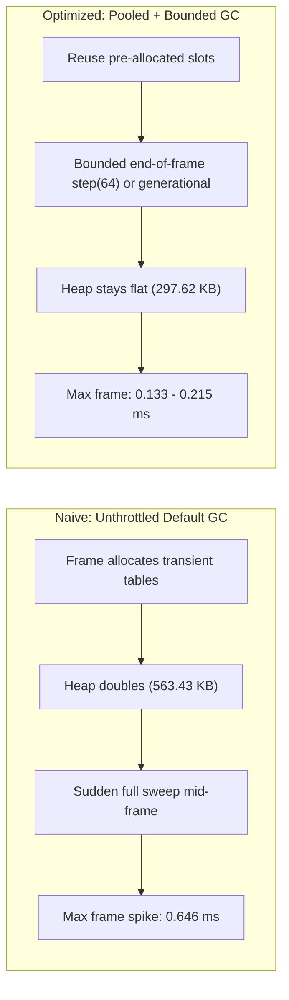

# Garbage Collector Tuning & Frame Budget Control in Lua

## Table of Contents

- [Introduction](#introduction)
- [What Actually Happens Under the Hood?](#what-actually-happens-under-the-hood)
- [Step-by-Step Code Walkthrough](#step-by-step-code-walkthrough)
  - [The Naive Approach: Unthrottled Default GC](#the-naive-approach-unthrottled-default-gc)
  - [The Optimized Approach: Pooled Slots + Bounded GC Step / Generational](#the-optimized-approach-pooled-slots--bounded-gc-step--generational)
- [Benchmark Results](#benchmark-results)
- [Common Pitfalls & When NOT to Use This](#common-pitfalls--when-not-to-use-this)
- [How to Diagnose GC Frame Spikes](#how-to-diagnose-gc-frame-spikes)
- [Summary Comparison](#summary-comparison)

---

## Introduction

Even after eliminating obvious hot-loop allocations, real games still allocate transient objects for UI notifications, dialogue lines, and asset state. Left on default incremental garbage collector settings, Lua waits for the heap to double before running major sweeps, which can trigger multi-millisecond frame-time spikes at unpredictable moments.

Conversely, calling `collectgarbage("collect")` every frame wastes CPU scanning the entire live heap. This lesson demonstrates how to combine **slot reuse** with **bounded `collectgarbage("step", step_size)`** and **Lua 5.4 `collectgarbage("generational")`** to keep frame times flat and predictable.

---

## What Actually Happens Under the Hood?

Lua 5.4 supports two GC modes:
1. **Incremental tri-color mark-and-sweep:** Objects transition from white (unvisited) to gray (marked, children unvisited) to black (marked with children visited). Running `collectgarbage("stop")` + `collectgarbage("step", step_kb)` at the end of each frame lets the engine pay a fixed, predictable GC budget per tick.
2. **Generational GC (Lua 5.4+):** Separates short-lived young objects from long-lived old objects. Minor collections only scan newly allocated young objects, cutting pause times dramatically when most garbage dies young.



---

## Step-by-Step Code Walkthrough

### The Naive Approach: Unthrottled Default GC

In [naive.lua](../naive.lua), every frame allocates `frame_events` and nested `payload` tables under default GC pacing:

```lua
frame_events[i] = {
    id = i,
    dx = (i % 7) * 0.5,
    dy = (f % 5) * 0.25,
    payload = { tag = "hit", mult = 1.0 + (i % 3) * 0.1 },
}
```

Peak heap climbs to `563.43 KB` and worst-frame latency hits `0.646 ms` during automatic collection cycles.

### The Optimized Approach: Pooled Slots + Bounded GC Step / Generational

In [optimized.lua](../optimized.lua), recurring event slots are pre-allocated once, and GC pacing is explicitly controlled:

```lua
if mode == "incremental_step" and not use_generational then
    collectgarbage("step", step_size)
end
```

When `"generational"` mode is selected, `supports_generational()` guards `collectgarbage("generational", 20, 100)` with `pcall` so the module also runs cleanly on LuaJIT/Lua 5.1. Before returning, the simulator always restores `collectgarbage("incremental")` and `collectgarbage("restart")`.

---

## Benchmark Results

Measured with Lua 5.4 (`lua lessons/GcTuning/benchmark.lua`) over 120 frames x 1,000 events/frame:

| Strategy | Time (s) | Max Frame (ms) | Peak Heap (KB) | Speedup |
|---|---:|---:|---:|---:|
| Naive (unthrottled GC) | 0.0425 | 0.646 | 563.43 | 1.00x |
| Pooled + GC `step(64)` | 0.0104 | 0.215 | 297.62 | 4.10x |
| Pooled + Generational GC | **0.0093** | **0.133** | 297.75 | **4.59x** |

---

## Common Pitfalls & When NOT to Use This

- **NEVER call `collectgarbage("stop")` without a guaranteed `step` or `restart`:** If an error or early return skips `collectgarbage("restart")`, memory will grow without bound until OOM. Always restore GC state in cleanup paths.
- **Do NOT call `collectgarbage("collect")` per frame:** A full stop-the-world sweep scans every reachable table in the entire game state, worsening frame times as your scene grows.
- **Watch long-lived references in generational mode:** If young objects are frequently promoted and immediately dropped, adjust `minor_mul` / `major_mul` or prefer incremental stepping.

---

## How to Diagnose GC Frame Spikes

1. **Track `collectgarbage("count")` and per-frame `os.clock()` deltas:** Correlating a sudden drop in `collectgarbage("count")` with a spike in frame time confirms a GC pause.
2. **Test with `collectgarbage("isrunning")` in automated checks:** Ensure your engine teardown or test harness never leaves the collector stopped.

---

## Summary Comparison

| Criterion | Unthrottled Default GC (`naive.lua`) | Pooled + `step(64)` (`optimized.lua`) | Pooled + Generational (`optimized.lua`) |
|---|---|---|---|
| Total time (120 frames) | 0.0425 s | 0.0104 s (4.10x) | **0.0093 s (4.59x)** |
| Max frame latency | 0.646 ms | 0.215 ms | **0.133 ms** |
| Peak heap | 563.43 KB | **297.62 KB** | 297.75 KB |
| Runtime compatibility | All Lua versions | All Lua versions | Lua 5.4+ (fallback on 5.1/LuaJIT) |
