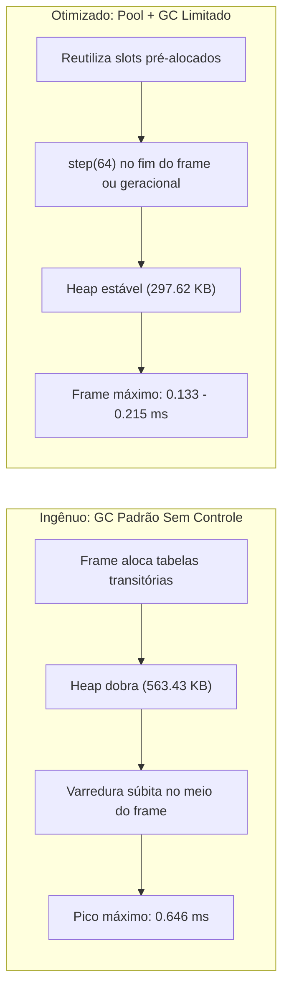

# Ajuste de Garbage Collector e Controle de Orçamento por Frame em Lua

## Índice

- [Introdução](#introdução)
- [O Que Realmente Acontece por Baixo dos Panos?](#o-que-realmente-acontece-por-baixo-dos-panos)
- [Passo a Passo do Código](#passo-a-passo-do-código)
  - [Abordagem Ingênua: GC Padrão Sem Controle](#abordagem-ingênua-gc-padrão-sem-controle)
  - [Abordagem Otimizada: Slots em Pool + `step` Limitado / Geracional](#abordagem-otimizada-slots-em-pool--step-limitado--geracional)
- [Resultados do Benchmark](#resultados-do-benchmark)
- [Armadilhas Comuns e Quando NÃO Usar](#armadilhas-comuns-e-quando-não-usar)
- [Como Diagnosticar Picos de GC por Frame](#como-diagnosticar-picos-de-gc-por-frame)
- [Tabela Resumo Comparativa](#tabela-resumo-comparativa)

---

## Introdução

Mesmo após remover alocações óbvias de loops críticos, jogos reais ainda alocam objetos temporários para UI, diálogos e estados transitórios. Com a configuração padrão do garbage collector incremental, Lua espera o heap dobrar antes de fazer varreduras maiores, causando picos de vários milissegundos no meio de um frame.

Por outro lado, chamar `collectgarbage("collect")` a cada frame desperdiça CPU varrendo todo o heap vivo. Esta lição mostra como combinar **reuso de slots** com **passos limitados `collectgarbage("step", step_size)`** e **GC geracional do Lua 5.4 (`collectgarbage("generational")`)** para manter o frame time estável.

---

## O Que Realmente Acontece por Baixo dos Panos?

Lua 5.4 oferece dois modos de GC:
1. **Incremental mark-and-sweep tricolor:** Objetos passam de branco (não visitado) para cinza (marcado, filhos pendentes) e preto (concluído). Usar `collectgarbage("stop")` + `collectgarbage("step", step_kb)` ao final de cada frame permite pagar um orçamento fixo e previsível de GC por tick.
2. **GC Geracional (Lua 5.4+):** Separa objetos jovens de vida curta dos objetos antigos. Coletas menores varrem apenas objetos jovens recém-alocados, reduzindo drasticamente as pausas.



---

## Passo a Passo do Código

### Abordagem Ingênua: GC Padrão Sem Controle

Em [naive.lua](../naive.lua), cada frame aloca `frame_events` e tabelas `payload` aninhadas sob o ritmo padrão do GC:

```lua
frame_events[i] = {
    id = i,
    dx = (i % 7) * 0.5,
    dy = (f % 5) * 0.25,
    payload = { tag = "hit", mult = 1.0 + (i % 3) * 0.1 },
}
```

O pico de heap sobe para `563.43 KB` e o pior frame chega a `0.646 ms` durante os ciclos automáticos de coleta.

### Abordagem Otimizada: Slots em Pool + `step` Limitado / Geracional

Em [optimized.lua](../optimized.lua), os slots de eventos são pré-alocados uma única vez e o ritmo do GC é controlado explicitamente:

```lua
if mode == "incremental_step" and not use_generational then
    collectgarbage("step", step_size)
end
```

No modo `"generational"`, `supports_generational()` protege `collectgarbage("generational", 20, 100)` com `pcall` para manter compatibilidade com LuaJIT/Lua 5.1. Antes de retornar, a simulação sempre restaura `collectgarbage("incremental")` e `collectgarbage("restart")`.

---

## Resultados do Benchmark

Medido em Lua 5.4 (`lua lessons/GcTuning/benchmark.lua`) em 120 frames x 1.000 eventos/frame:

| Estratégia | Tempo (s) | Pior Frame (ms) | Pico Heap (KB) | Speedup |
|---|---:|---:|---:|---:|
| Ingênuo (GC sem controle) | 0.0425 | 0.646 | 563.43 | 1.00x |
| Pool + GC `step(64)` | 0.0104 | 0.215 | 297.62 | 4.10x |
| Pool + GC Geracional | **0.0093** | **0.133** | 297.75 | **4.59x** |

---

## Armadilhas Comuns e Quando NÃO Usar

- **NUNCA chame `collectgarbage("stop")` sem garantir `step` ou `restart`:** Se um erro ou retorno antecipado pular `collectgarbage("restart")`, a memória crescerá sem limite até esgotar a RAM.
- **NÃO chame `collectgarbage("collect")` por frame:** Uma coleta completa varre toda a árvore de objetos vivos da engine, piorando o frame time conforme a cena cresce.
- **Observe promoções no modo geracional:** Se muitos objetos sobreviverem tempo suficiente para virar antigos e logo morrerem, ajuste `minor_mul`/`major_mul` ou use passos incrementais.

---

## Como Diagnosticar Picos de GC por Frame

1. **Correlacione `collectgarbage("count")` com deltas de `os.clock()`:** Uma queda brusca em `collectgarbage("count")` acompanhada de um pico de latência confirma pausa de GC.
2. **Valide `collectgarbage("isrunning")` em testes automatizados:** Garanta que nenhum módulo deixe o coletor parado após o uso.

---

## Tabela Resumo Comparativa

| Critério | GC Padrão (`naive.lua`) | Pool + `step(64)` (`optimized.lua`) | Pool + Geracional (`optimized.lua`) |
|---|---|---|---|
| Tempo total (120 frames) | 0.0425 s | 0.0104 s (4.10x) | **0.0093 s (4.59x)** |
| Latência máxima | 0.646 ms | 0.215 ms | **0.133 ms** |
| Pico de heap | 563.43 KB | **297.62 KB** | 297.75 KB |
| Compatibilidade | Todas versões Lua | Todas versões Lua | Lua 5.4+ (fallback em 5.1/LuaJIT) |
