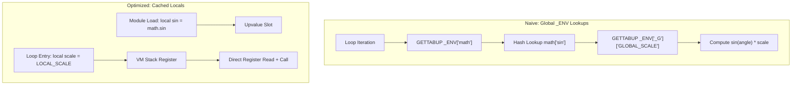

# Locals vs Globals in Lua

## Table of Contents

- [Introduction](#introduction)
- [How Lua Resolves Globals vs. Locals](#how-lua-resolves-globals-vs-locals)
- [VM Registers and Upvalues Explained](#vm-registers-and-upvalues-explained)
- [Naive vs. Localized Walkthrough](#naive-vs-localized-walkthrough)
  - [Naive: Repeated `_ENV` Hash Lookups](#naive-repeated-_env-hash-lookups)
  - [Optimized: Cached Module Locals and Upvalues](#optimized-cached-module-locals-and-upvalues)
- [Pitfalls, Trade-offs, and When NOT to Use](#pitfalls-trade-offs-and-when-not-to-use)
- [Profiling Tips](#profiling-tips)
- [Summary](#summary)

---

## Introduction

Imagine a carpenter building a roof. If you keep your hammer and tape measure in your tool belt, grabbing them takes a single reach. If you leave them in a locked warehouse across the street and have to ask the clerk to look them up in a catalog every time you drive a nail, the actual hammering becomes the smallest part of the job.

In Lua, `local` variables sit in your tool belt (VM registers), while global names like `math.sin` or `_G.GLOBAL_SCALE` live in the warehouse (`_ENV`). Inside a hot loop running a million times per second, those repeated hash-table lookups quietly dominate CPU time.

---

## How Lua Resolves Globals vs. Locals

Lua has no special "global variable" storage. Every free name is syntactic sugar for indexing the `_ENV` upvalue table (`_ENV["math"]`). Evaluating `math.sin(angle)` inside a loop performs **two** hash-table lookups on every iteration:

1. `GETTABUP`: Hash-lookup `"math"` inside `_ENV`.
2. `GETFIELD` / `GETTABLE`: Hash-lookup `"sin"` inside the `math` table.

By contrast, `local` variables live directly in the function's fixed-size **VM register array** (indexed by integer slot, no hashing).

```text
Global Access: math.sin(angle)         Local Access: sin(angle)
+--------+   hash    +------+          +----------------------+
| _ENV   | --------> | math |          | VM Register / Upval  |
+--------+  ("math") +------+          | [slot 3] -> sin fn   |
                         |             +----------------------+
                    hash | ("sin")                 |
                         v                         v
                     +-------+             Direct O(1) index
                     | sin() |             (Zero hash lookups)
                     +-------+
```



---

## VM Registers and Upvalues Explained

A Lua 5.4 function frame stores its `local` variables in a contiguous array of up to **250 registers** on the Lua stack. Reading a local is a direct pointer offset (`R[idx]`), which is a single CPU memory load.

When a function references a `local` declared at module scope (such as `local sin = math.sin`), it becomes an **upvalue**. Fetching an upvalue (`GETUPVAL`) is an indirect pointer dereference—still much faster than hashing strings in `_ENV`. Copying a loop-invariant upvalue into a function-local variable (`local scale = LOCAL_SCALE`) before entering a loop promotes it straight into a stack register (`MOVE`).

---

## Naive vs. Localized Walkthrough

### Naive: Repeated `_ENV` Hash Lookups

In `lessons/LocalsVsGlobals/naive.lua`, every iteration resolves `math.sin`, `math.cos`, `math.sqrt`, and `_G.GLOBAL_SCALE` from scratch:

```lua
for i = 1, iterations do
    local angle = i * step
    local dx = math.sin(angle) * _G.GLOBAL_SCALE
    local dy = math.cos(angle) * _G.GLOBAL_SCALE
    sum = sum + math.sqrt(dx * dx + dy * dy)
end
```

Across `1,000,000` iterations, that triggers `10,000,000` hash-table lookups (`_ENV`, `math`, `_G`) that never change value.

### Optimized: Cached Module Locals and Upvalues

In `lessons/LocalsVsGlobals/optimized.lua`, hot functions are bound once at module load, and `LOCAL_SCALE` is copied into a local register before the loop:

```lua
local sin = math.sin
local cos = math.cos
local sqrt = math.sqrt
local LOCAL_SCALE = 2.5

-- Inside M.evaluate(iterations):
local scale = LOCAL_SCALE
for i = 1, iterations do
    local angle = i * step
    local dx = sin(angle) * scale
    local dy = cos(angle) * scale
    sum = sum + sqrt(dx * dx + dy * dy)
end
```

---

## Pitfalls, Trade-offs, and When NOT to Use

- **Stale Monkey-Patching**: If a test or mod replaces `_G.math.sin` after your module loads, `local sin = math.sin` still points to the original function.
- **200-Local Limit**: Lua 5.4 enforces a hard limit of 200 active local variables per scope (250 registers total). Group related helpers into a small table or split large functions instead of caching dozens of rarely used functions.
- **When NOT to Use**: Do not clutter cold initialization code, UI setup, or one-off config loaders with `local` aliases. Keep localization focused on tight inner loops (physics, pathfinding, rendering).

---

## Profiling Tips

1. **Inspect Lua Bytecode**: Run `luac -l lessons/LocalsVsGlobals/naive.lua` vs `optimized.lua` to see `GETTABUP` hash lookups disappear in favor of `GETUPVAL` and `MOVE`.
2. **Note on LuaJIT**: LuaJIT's tracing JIT can hoist constant global lookups out of compiled traces, so the speedup is most pronounced in Lua 5.4 / PUC-Rio Lua or interpreter-heavy code paths. Verify with `luajit -jv`.

---

## Summary

Workload: `1,000,000` trig/distance evaluations on `Lua 5.4.7` (`lessons/LocalsVsGlobals/Benchmark.md`).

| Metric | Naive (`_ENV` / `_G` Lookups) | Cached `local` & Upvalues |
|---|---|---|
| Execution Time | `0.1618 s` | **`0.1048 s` (`1.54x` faster)** |
| Hash Lookups per Iteration | 10 (`_ENV`, `math`, `_G`) | **0** |
| VM Mechanism | `GETTABUP` + hash probe | `GETUPVAL` / stack register |
| Trade-off | Dynamic monkey-patching works | Captures reference at load time |
