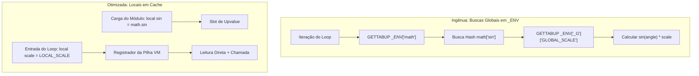

# Locals vs Globals em Lua

## Sumário

- [Introdução](#introdução)
- [Como Lua Resolve Globais vs. Locais](#como-lua-resolve-globais-vs-locais)
- [Registradores da VM e Upvalues Explicados](#registradores-da-vm-e-upvalues-explicados)
- [Passo a Passo: Abordagem Ingênua vs. Cache Local](#passo-a-passo-abordagem-ingênua-vs-cache-local)
  - [Ingênua: Buscas Repetidas em `_ENV`](#ingênua-buscas-repetidas-em-_env)
  - [Otimizada: Locais e Upvalues em Cache](#otimizada-locais-e-upvalues-em-cache)
- [Armadilhas, Trade-offs e Quando NÃO Usar](#armadilhas-trade-offs-e-quando-não-usar)
- [Dicas de Profiling](#dicas-de-profiling)
- [Resumo](#resumo)

---

## Introdução

Imagine um carpinteiro construindo um telhado. Se o martelo e a trena estão no cinto de ferramentas, alcançá-los leva um instante. Se você os deixa em um depósito trancado do outro lado da rua e precisa pedir ao atendente para consultar um catálogo a cada prego batido, o trabalho real vira a menor parte do tempo gasto.

Em Lua, variáveis `local` ficam no seu cinto de ferramentas (registradores da VM), enquanto nomes globais como `math.sin` ou `_G.GLOBAL_SCALE` moram no depósito (`_ENV`). Dentro de um loop quente rodando um milhão de vezes, essas buscas repetidas em tabela hash dominam o tempo de CPU.

---

## Como Lua Resolve Globais vs. Locais

Lua não possui armazenamento separado para "variáveis globais". Todo nome livre é açúcar sintático para indexar a tabela upvalue `_ENV` (`_ENV["math"]`). Avaliar `math.sin(angle)` dentro de um loop executa **duas** buscas hash a cada iteração:

1. `GETTABUP`: Busca hash por `"math"` dentro de `_ENV`.
2. `GETFIELD` / `GETTABLE`: Busca hash por `"sin"` dentro da tabela `math`.

Já variáveis `local` vivem diretamente no **array de registradores da VM** da função (indexado por posição inteira, sem hash).

```text
Acesso Global: math.sin(angle)         Acesso Local: sin(angle)
+--------+   hash    +------+          +----------------------+
| _ENV   | --------> | math |          | Registrador / Upval  |
+--------+  ("math") +------+          | [slot 3] -> fn sin   |
                         |             +----------------------+
                    hash | ("sin")                 |
                         v                         v
                     +-------+             Índice O(1) direto
                     | sin() |             (Zero buscas hash)
                     +-------+
```



---

## Registradores da VM e Upvalues Explicados

O frame de uma função em Lua 5.4 guarda suas variáveis `local` em um array contíguo de até **250 registradores** na pilha da VM. Ler uma variável local é um deslocamento direto de ponteiro (`R[idx]`), uma única leitura de memória na CPU.

Quando uma função acessa uma `local` declarada no escopo do módulo (como `local sin = math.sin`), ela vira um **upvalue**. Buscar um upvalue (`GETUPVAL`) é uma indireção de ponteiro — ainda muito mais rápida que calcular hash em `_ENV`. Copiar um upvalue constante para uma local da função (`local scale = LOCAL_SCALE`) antes do loop o promove direto para um registrador (`MOVE`).

---

## Passo a Passo: Abordagem Ingênua vs. Cache Local

### Ingênua: Buscas Repetidas em `_ENV`

Em `lessons/LocalsVsGlobals/naive.lua`, cada iteração resolve `math.sin`, `math.cos`, `math.sqrt` e `_G.GLOBAL_SCALE` do zero:

```lua
for i = 1, iterations do
    local angle = i * step
    local dx = math.sin(angle) * _G.GLOBAL_SCALE
    local dy = math.cos(angle) * _G.GLOBAL_SCALE
    sum = sum + math.sqrt(dx * dx + dy * dy)
end
```

Em `1.000.000` de iterações, isso dispara `10.000.000` de buscas em tabela hash (`_ENV`, `math`, `_G`) cujos valores nunca mudam.

### Otimizada: Locais e Upvalues em Cache

Em `lessons/LocalsVsGlobals/optimized.lua`, funções quentes são vinculadas uma vez no carregamento do módulo, e `LOCAL_SCALE` é copiada para um registrador local antes do loop:

```lua
local sin = math.sin
local cos = math.cos
local sqrt = math.sqrt
local LOCAL_SCALE = 2.5

-- Dentro de M.evaluate(iterations):
local scale = LOCAL_SCALE
for i = 1, iterations do
    local angle = i * step
    local dx = sin(angle) * scale
    local dy = cos(angle) * scale
    sum = sum + sqrt(dx * dx + dy * dy)
end
```

---

## Armadilhas, Trade-offs e Quando NÃO Usar

- **Monkey-Patching Desatualizado**: Se um teste ou mod substituir `_G.math.sin` depois que o módulo carregou, `local sin = math.sin` continua apontando para a função antiga.
- **Limite de 200 Locais**: Lua 5.4 impõe um limite rígido de 200 variáveis locais ativas por escopo (250 registradores no total). Agrupe helpers relacionados em uma tabela ou divida funções grandes em vez de criar dezenas de aliases pouco usados.
- **Quando NÃO Usar**: Não polua código frio de inicialização, telas de UI ou leitores de configuração com aliases `local`. Foque em loops internos críticos (física, simulação, renderização).

---

## Dicas de Profiling

1. **Inspecione o Bytecode Lua**: Rode `luac -l lessons/LocalsVsGlobals/naive.lua` versus `optimized.lua` para ver instruções `GETTABUP` sumirem em favor de `GETUPVAL` e `MOVE`.
2. **Nota sobre LuaJIT**: O compilador JIT do LuaJIT consegue içar buscas globais constantes para fora de traces compilados, portanto o ganho é mais visível em Lua 5.4 / PUC-Rio ou caminhos interpretados. Verifique com `luajit -jv`.

---

## Resumo

Carga: `1.000.000` de avaliações trigonométricas no `Lua 5.4.7` (`lessons/LocalsVsGlobals/Benchmark.md`).

| Métrica | Ingênua (Buscas `_ENV` / `_G`) | `local` e Upvalues em Cache |
|---|---|---|
| Tempo de Execução | `0.1618 s` | **`0.1048 s` (`1.54x` mais rápido)** |
| Buscas Hash por Iteração | 10 (`_ENV`, `math`, `_G`) | **0** |
| Mecanismo da VM | `GETTABUP` + sonda hash | `GETUPVAL` / registrador |
| Trade-off | Permite monkey-patching dinâmico | Fixa a referência no load |
