```mermaid
flowchart TD
    classDef slow fill:#fee2e2,stroke:#dc2626,color:#111827
    classDef fast fill:#dcfce7,stroke:#16a34a,color:#111827
    classDef vm fill:#dbeafe,stroke:#2563eb,color:#111827
    classDef warn fill:#fef3c7,stroke:#d97706,color:#111827

    subgraph Naive["Naive: 4-Level __index Fallback Chain"]
        E1["entities[i]:step(dt)<br/>(SELF opcode + CALL)"]:::warn --> H1["Miss on instance -> check CombatUnit<br/>(metatable __index lookup #1)"]:::slow
        H1 --> H2["step() calls apply_damping()<br/>(misses -> Entity -> BaseObject)"]:::slow
        H2 --> H3["get_drag() / get_gravity()<br/>(4 __index hops + 5 call frames)"]:::slow
        H3 --> H4["integrate() reads self.accel_scale<br/>(3 more misses -> BaseObject)"]:::slow
    end

    subgraph Optimized["Optimized: Flat Data + Batch Loop"]
        O1["Hoist DRAG, GRAVITY, ACCEL_SCALE<br/>to local VM registers once"]:::vm --> O2["for i = 1, n do"]:::vm
        O2 --> O3["Read e.vx, e.vy, e.x, e.y directly<br/>(0 __index hops, 0 method calls)"]:::fast
        O3 --> O4["Update in-place<br/>(6.71x faster)"]:::fast
    end
```

# Metatable Overhead: Deep `__index` Chains vs Flat Functions

## Table of Contents

- [Introduction](#introduction)
- [How Chained `__index` Lookups Work in Lua](#how-chained-__index-lookups-work-in-lua)
- [Method Dispatch (`SELF`) vs. Flat Batch Loops](#method-dispatch-self-vs-flat-batch-loops)
- [Naive vs. Flat Batch Walkthrough](#naive-vs-flat-batch-walkthrough)
  - [Naive: 4-Level `__index` Prototype Chain](#naive-4-level-__index-prototype-chain)
  - [Optimized: Flat Data Tables and Local Batch Loop](#optimized-flat-data-tables-and-local-batch-loop)
- [Pitfalls, Trade-offs, and When NOT to Use](#pitfalls-trade-offs-and-when-not-to-use)
- [Profiling Tips](#profiling-tips)
- [Summary](#summary)

---

## Introduction

Imagine an assembly line where, for every screw a worker turns, they walk to a supervisor, who calls a manager, who calls the regional director, who finally reads the torque spec from a binder. Even if the spec never changes, the chain of phone calls consumes almost the entire shift.

In Lua, deep object-oriented class hierarchies built with chained `__index` metatables behave the exact same way. Every method call and default constant read walks up the prototype chain on every entity, every frame.

---

## How Chained `__index` Lookups Work in Lua

When you access `obj[key]` on a Lua table and `key` is missing from `obj`:

1. The VM checks `getmetatable(obj).__index`.
2. If `__index` is a table (like `CombatUnit`), Lua hashes `key` inside `CombatUnit`.
3. If `key` is missing there too, Lua repeats the check on `CombatUnit`'s metatable (`MobileActor`), then `Entity`, then `BaseObject`.

```text
Naive 4-Level __index Chain                 Optimized Flat Table + Locals
[instance] (x, y, vx, vy)                   [instance] (x, y, vx, vy)
    | __index miss                              |
    v                                           v
[CombatUnit]  --> step()                    Local VM Registers:
    | __index miss                            drag = 0.995
    v                                         grav_dt = 9.81 * dt
[MobileActor] --> integrate()                 dt_scale = dt * 1.25
    | __index miss                          (Zero __index hops, zero SELF calls)
    v
[Entity]      --> apply_damping()
    | __index miss
    v
[BaseObject]  --> get_drag(), drag, gravity
```



---

## Method Dispatch (`SELF`) vs. Flat Batch Loops

Writing `self:apply_damping(dt)` emits a `SELF` opcode (which looks up the method on `self` and automatically passes `self` as the first argument) followed by `CALL`. Inside `naive.lua`, a single `entity:step(dt)` triggers **5 method calls** (`step`, `apply_damping`, `get_drag`, `get_gravity`, `integrate`) plus **3 prototype field reads** (`drag`, `gravity`, `accel_scale`), each walking up to 4 metatable hops.

Moving constants into module `local` registers and processing flat `{ x, y, vx, vy }` tables in a single `for i = 1, n` loop removes every `__index` hop and every function call frame per entity.

---

## Naive vs. Flat Batch Walkthrough

### Naive: 4-Level `__index` Prototype Chain

In `lessons/MetatableOverhead/naive.lua`, `CombatUnit` inherits from `MobileActor`, `Entity`, and `BaseObject`:

```lua
function CombatUnit:step(dt)
    self:apply_damping(dt)
    self:integrate(dt)
end
```

Because `drag`, `gravity`, and `accel_scale` live on `BaseObject`, even `self.accel_scale` inside `MobileActor:integrate` misses 3 tables before finding `1.25`.

### Optimized: Flat Data Tables and Local Batch Loop

In `lessons/MetatableOverhead/optimized.lua`, entities have no metatable at all, and invariant products are precomputed outside the loop:

```lua
local drag = DRAG
local grav_dt = GRAVITY * dt
local dt_scale = dt * ACCEL_SCALE

for _ = 1, steps do
    for i = 1, n do
        local e = entities[i]
        local vx = e.vx * drag
        local vy = (e.vy - grav_dt) * drag
        e.vx = vx
        e.vy = vy
        e.x = e.x + vx * dt_scale
        e.y = e.y + vy * dt_scale
    end
end
```

---

## Pitfalls, Trade-offs, and When NOT to Use

- **Loss of Polymorphic Dispatch**: Flat batch loops assume all entities in `entities` share the same update math. If you have 20 distinct enemy behaviors, group them into separate typed arrays (one array per behavior) rather than adding `if/else` chains inside one loop.
- **When Single-Level Metatables Are Fine**: A **1-level** metatable (`Pool.__index = Pool` for an object pool, UI widgets, or scene managers called once per frame) adds negligible cost and keeps public APIs ergonomic. Reserve flat batch loops for hot per-entity inner loops.

---

## Profiling Tips

1. **Count `SELF` and `CALL` Opcodes**: Inspect `luac -l lessons/MetatableOverhead/naive.lua` vs `optimized.lua` to see how many `SELF`/`CALL` pairs run per entity.
2. **LuaJIT Behavior**: LuaJIT can inline monomorphic `__index` chains on trace, but polymorphic hierarchies (multiple subtypes in one loop) cause trace exits and fall back to slow interpreter lookups.

---

## Summary

Workload: `20,000` entities updated over `60` steps (`1,200,000` updates) on `Lua 5.4.7` (`lessons/MetatableOverhead/Benchmark.md`).

| Metric | Naive (4-Level `__index`) | Optimized (Flat + Batch Loop) |
|---|---|---|
| Execution Time (`60` steps) | `0.4569 s` | **`0.0681 s` (`6.71x` faster)** |
| `__index` Hops per Entity | Up to 4 per lookup | **0** |
| Method Calls per Entity | 5 (`step` -> `get_gravity`) | **0** |
| Checksum | `1020707.88` | `1020707.88` |
