```mermaid
flowchart TD
    classDef slow fill:#fee2e2,stroke:#dc2626,color:#111827
    classDef fast fill:#dcfce7,stroke:#16a34a,color:#111827
    classDef vm fill:#dbeafe,stroke:#2563eb,color:#111827
    classDef warn fill:#fef3c7,stroke:#d97706,color:#111827

    subgraph Naive["Ingênua: Cadeia __index de 4 Níveis"]
        E1["entities[i]:step(dt)<br/>(opcode SELF + CALL)"]:::warn --> H1["Falta na instância -> checa CombatUnit<br/>(busca __index #1 na metatable)"]:::slow
        H1 --> H2["step() chama apply_damping()<br/>(falha -> Entity -> BaseObject)"]:::slow
        H2 --> H3["get_drag() / get_gravity()<br/>(4 saltos __index + 5 chamadas)"]:::slow
        H3 --> H4["integrate() lê self.accel_scale<br/>(mais 3 falhas -> BaseObject)"]:::slow
    end

    subgraph Optimized["Otimizada: Dados Planos + Loop em Lote"]
        O1["Subir DRAG, GRAVITY, ACCEL_SCALE<br/>para registradores locais uma vez"]:::vm --> O2["for i = 1, n do"]:::vm
        O2 --> O3["Ler e.vx, e.vy, e.x, e.y direto<br/>(0 saltos __index, 0 chamadas)"]:::fast
        O3 --> O4["Atualizar in-place<br/>(6.71x mais rápido)"]:::fast
    end
```

# Overhead de Metatables: Cadeias Profundas de `__index` vs Funções Planas

## Sumário

- [Introdução](#introdução)
- [Como Buscas Encadeadas de `__index` Funcionam em Lua](#como-buscas-encadeadas-de-__index-funcionam-em-lua)
- [Despacho de Métodos (`SELF`) vs. Loops em Lote](#despacho-de-métodos-self-vs-loops-em-lote)
- [Passo a Passo: Cadeia `__index` vs. Loop em Lote](#passo-a-passo-cadeia-__index-vs-loop-em-lote)
  - [Ingênua: Hierarquia `__index` de 4 Níveis](#ingênua-hierarquia-__index-de-4-níveis)
  - [Otimizada: Tabelas Planas e Loop Local em Lote](#otimizada-tabelas-planas-e-loop-local-em-lote)
- [Armadilhas, Trade-offs e Quando NÃO Usar](#armadilhas-trade-offs-e-quando-não-usar)
- [Dicas de Profiling](#dicas-de-profiling)
- [Resumo](#resumo)

---

## Introdução

Imagine uma linha de montagem onde, a cada parafuso apertado, o operário caminha até o supervisor, que liga para o gerente, que liga para o diretor regional, que finalmente lê o torque padrão em um fichário. Mesmo que o valor nunca mude, a cadeia de ligações consome quase todo o turno.

Em Lua, hierarquias profundas de orientação a objetos feitas com metatables `__index` encadeadas funcionam exatamente assim. Cada chamada de método e leitura de constante percorre a cadeia de protótipos para cada entidade, a cada frame.

---

## Como Buscas Encadeadas de `__index` Funcionam em Lua

Quando você acessa `obj[key]` em uma tabela Lua e `key` não existe em `obj`:

1. A VM verifica `getmetatable(obj).__index`.
2. Se `__index` for uma tabela (como `CombatUnit`), Lua calcula o hash de `key` dentro de `CombatUnit`.
3. Se `key` também faltar ali, Lua repete a busca na metatable de `CombatUnit` (`MobileActor`), depois `Entity` e então `BaseObject`.

```text
Cadeia __index de 4 Níveis                  Tabela Plana + Locais
[instância] (x, y, vx, vy)                  [instância] (x, y, vx, vy)
    | __index miss                              |
    v                                           v
[CombatUnit]  --> step()                    Registradores Locais da VM:
    | __index miss                            drag = 0.995
    v                                         grav_dt = 9.81 * dt
[MobileActor] --> integrate()                 dt_scale = dt * 1.25
    | __index miss                          (Zero saltos __index, zero SELF)
    v
[Entity]      --> apply_damping()
    | __index miss
    v
[BaseObject]  --> get_drag(), drag, gravity
```



---

## Despacho de Métodos (`SELF`) vs. Loops em Lote

Escrever `self:apply_damping(dt)` gera um opcode `SELF` (que busca o método em `self` e passa `self` automaticamente como primeiro argumento) seguido de `CALL`. Em `naive.lua`, uma única chamada `entity:step(dt)` dispara **5 chamadas de método** (`step`, `apply_damping`, `get_drag`, `get_gravity`, `integrate`) mais **3 leituras de campo protótipo** (`drag`, `gravity`, `accel_scale`), cada uma percorrendo até 4 saltos de metatable.

Mover constantes para variáveis `local` do módulo e processar tabelas planas `{ x, y, vx, vy }` em um único `for i = 1, n` elimina todos os saltos `__index` e todos os frames de chamada por entidade.

---

## Passo a Passo: Cadeia `__index` vs. Loop em Lote

### Ingênua: Hierarquia `__index` de 4 Níveis

Em `lessons/MetatableOverhead/naive.lua`, `CombatUnit` herda de `MobileActor`, `Entity` e `BaseObject`:

```lua
function CombatUnit:step(dt)
    self:apply_damping(dt)
    self:integrate(dt)
end
```

Como `drag`, `gravity` e `accel_scale` moram em `BaseObject`, até `self.accel_scale` em `MobileActor:integrate` falha em 3 tabelas antes de achar `1.25`.

### Otimizada: Tabelas Planas e Loop Local em Lote

Em `lessons/MetatableOverhead/optimized.lua`, entidades não têm metatable alguma, e produtos invariantes são pré-calculados fora do loop:

```lua
local drag = DRAG
local grav_dt = GRAVITY * dt
local dt_scale = dt * ACCEL_SCALE

for _ = 1, steps do
    for i = 1, n do
        local e = entities[i]
        local vx = e.vx * drag
        local vy = (e.vy - grav_dt) * drag
        e.vx = vx
        e.vy = vy
        e.x = e.x + vx * dt_scale
        e.y = e.y + vy * dt_scale
    end
end
```

---

## Armadilhas, Trade-offs e Quando NÃO Usar

- **Perda de Polimorfismo por Instância**: Loops em lote assumem que todas as entidades em `entities` seguem a mesma matemática. Se houver 20 comportamentos distintos, separe-os em arrays tipados (um array por tipo) em vez de encher um único loop com `if/else`.
- **Quando Metatables de 1 Nível São Adequadas**: Uma metatable de **1 nível** (`Pool.__index = Pool` em um object pool, widgets de UI ou gerenciadores de cena chamados 1x por frame) tem custo desprezível e mantém APIs limpas. Reserve loops planos para loops internos quentes por entidade.

---

## Dicas de Profiling

1. **Conte Opcodes `SELF` e `CALL`**: Inspecione `luac -l lessons/MetatableOverhead/naive.lua` vs `optimized.lua` para ver quantos pares `SELF`/`CALL` rodam por entidade.
2. **Comportamento no LuaJIT**: O LuaJIT consegue fazer inline de cadeias `__index` monomórficas em traces, mas hierarquias polimórficas (vários subtipos no mesmo loop) causam saídas de trace e caem para o interpretador lento.

---

## Resumo

Carga: `20.000` entidades atualizadas por `60` passos (`1.200.000` atualizações) no `Lua 5.4.7` (`lessons/MetatableOverhead/Benchmark.md`).

| Métrica | Ingênua (`__index` 4 Níveis) | Otimizada (Plana + Loop em Lote) |
|---|---|---|
| Tempo de Execução (`60` passos) | `0.4569 s` | **`0.0681 s` (`6.71x` mais rápido)** |
| Saltos `__index` por Entidade | Até 4 por busca | **0** |
| Chamadas de Método por Entidade | 5 (`step` -> `get_gravity`) | **0** |
| Checksum | `1020707.88` | `1020707.88` |
