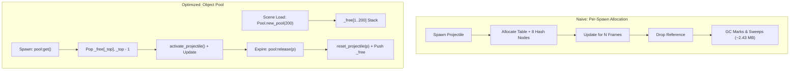

# Object Pooling in Lua

## Table of Contents

- [Introduction](#introduction)
- [Why Per-Spawn Tables Hurt Frame Pacing](#why-per-spawn-tables-hurt-frame-pacing)
- [How a Free-List Object Pool Works](#how-a-free-list-object-pool-works)
- [Naive vs. Pooled Walkthrough](#naive-vs-pooled-walkthrough)
  - [Naive: Per-Spawn Allocation](#naive-per-spawn-allocation)
  - [Optimized: Pre-Allocated Free-List Pool](#optimized-pre-allocated-free-list-pool)
- [Pitfalls, Trade-offs, and When NOT to Use](#pitfalls-trade-offs-and-when-not-to-use)
- [Profiling Tips](#profiling-tips)
- [Summary](#summary)

---

## Introduction

Think of a busy coffee shop. If you threw away every ceramic plate after a single customer finished eating and bought a brand-new one for the next order, your kitchen would drown in trash and spend half its budget on deliveries. Instead, you wash the plate and put it back on the stack.

In Lua game loops, short-lived entities like bullets, particles, damage popups, and sound emitters behave just like those plates. Calling `{ x = x, y = y, vx = vx, vy = vy, ttl = ttl, active = true }` on every spawn forces the Lua runtime to allocate, hash, and later garbage-collect thousands of identical tables. An **object pool** pre-allocates those tables once and recycles them through a fast array-backed stack.

---

## Why Per-Spawn Tables Hurt Frame Pacing

In Lua 5.4 and LuaJIT, every `{ ... }` constructor allocates a `Table` C struct on the heap. For a projectile with 6 named fields (`x`, `y`, `vx`, `vy`, `ttl`, `active`), the runtime allocates:

1. **Table Header**: ~40–56 bytes for GC metadata, array pointer, hash pointer, and metatable reference.
2. **Hash Node Array**: Space for 8 hash `Node` slots (next power of two above 6 keys), totaling ~248 bytes per projectile in our benchmark.
3. **GC Write Barriers and Sweeps**: Every new table enters the incremental mark-and-sweep collector's object list.

```text
Heap (Naive: 10,000 spawns)          Heap (Pooled: 200 capacity)
+-------------------------+          +-------------------------+
| proj #1   (~248 B) [GC] |          | _free[1..200] (~50 KB)  |
| proj #2   (~248 B) [GC] |          | allocated once at load  |
| ...                     |          +-------------------------+
| proj #10000 (~248 B)[GC]|                    |
+-------------------------+                    v
   ~2.43 MB heap churn               0 KB steady-state delta
```



---

## How a Free-List Object Pool Works

`lessons/ObjectPooling/optimized.lua` implements a stack-based pool using a dense `1..n` Lua array (`_free`) and an integer cursor (`_top`):

- **Pre-warming**: `Pool.new_pool(capacity, factory, reset)` calls `factory()` and `reset(obj)` `capacity` times during initialization so all hash slots exist upfront.
- **O(1) Acquire (`Pool:get`)**: Reads `self._free[self._top]`, clears the slot (`nil`) so the pool does not hold a duplicate reference while active, and decrements `_top`.
- **O(1) Release (`Pool:release`)**: Calls `self._reset(obj)` to wipe stale fields, increments `_top`, and stores `obj` back at `self._free[self._top]`.

---

## Naive vs. Pooled Walkthrough

### Naive: Per-Spawn Allocation

In `lessons/ObjectPooling/naive.lua`, every wave allocates fresh tables and drops them on expiry:

```lua
function M.create_projectile(x, y, vx, vy, ttl)
    return {
        x = x or 0,
        y = y or 0,
        vx = vx or 0,
        vy = vy or 0,
        ttl = ttl or 0,
        active = true,
    }
end
```

Inside `M.simulate`, expired projectiles are removed from `active` via swap-and-pop, leaving the discarded table for the GC to reclaim later.

### Optimized: Pre-Allocated Free-List Pool

In `lessons/ObjectPooling/optimized.lua`, the pool owns table creation and lifecycle:

```lua
function Pool:get()
    if self._top == 0 then
        error("object pool exhausted", 2)
    end
    local obj = self._free[self._top]
    self._free[self._top] = nil
    self._top = self._top - 1
    self._active = self._active + 1
    return obj
end
```

When `M.step(p, dt)` returns `false`, `M.simulate` swaps the projectile out of `active` and calls `pool:release(p)`, which runs `M.reset_projectile(p)` before pushing `p` back onto `_free`.

---

## Pitfalls, Trade-offs, and When NOT to Use

- **Stale State Leaks**: Forgetting to reset even one field in `reset(obj)` causes recycled projectiles to inherit old velocities or flags.
- **Use-After-Release (Aliasing)**: Holding a reference to `p` after `pool:release(p)` means two systems can mutate the same table simultaneously.
- **Fixed Capacity**: Sizing `capacity` too small triggers `"object pool exhausted"`; sizing it wildly high wastes memory. Measure peak concurrent entities per scene.
- **When NOT to Use**: Skip pooling for long-lived singletons (player state, level config), rare events (menu screens), or heterogeneous tables whose keys change dynamically (which triggers hash rehashing anyway).

---

## Profiling Tips

1. **Measure Steady-State GC Delta**: Call `collectgarbage("collect")`, `collectgarbage("stop")`, and compare `collectgarbage("count")` before and after your update loop. A healthy pool shows `~0 KB` delta.
2. **LuaJIT Trace Checks**: Run `luajit -jv your_script.lua` to confirm `Pool:get()` and `Pool:release()` inline cleanly without trace aborts from `error()` paths.

---

## Summary

Workload: `10,000` projectile cycles (`batch_size = 200`, `lifetime = 4` frames) on `Lua 5.4.7` (`lessons/ObjectPooling/Benchmark.md`).

| Metric | Naive (`create_projectile`) | Pooled (`Pool:get` / `Pool:release`) |
|---|---|---|
| Execution Time | `0.0088 s` | **`0.0067 s` (`1.33x` faster)** |
| GC Heap Delta | `2426.55 KB` | **`0.06 KB` (~`0 KB`)** |
| Per-Spawn Allocations | 1 table + hash nodes | **0** |
| Main Risk | GC frame stutters | Stale state / aliasing on release |
