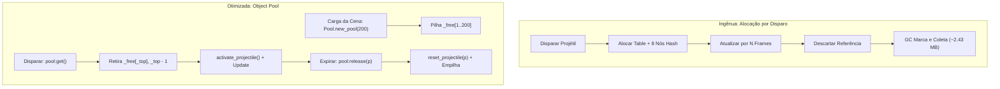

# Object Pooling em Lua

## Sumário

- [Introdução](#introdução)
- [Por que Tabelas por Disparo Prejudicam o Frame Rate](#por-que-tabelas-por-disparo-prejudicam-o-frame-rate)
- [Como Funciona um Object Pool com Free-List](#como-funciona-um-object-pool-com-free-list)
- [Passo a Passo: Abordagem Ingênua vs. Pool](#passo-a-passo-abordagem-ingênua-vs-pool)
  - [Ingênua: Alocação por Disparo](#ingênua-alocação-por-disparo)
  - [Otimizada: Pool Pré-Alocado](#otimizada-pool-pré-alocado)
- [Armadilhas, Trade-offs e Quando NÃO Usar](#armadilhas-trade-offs-e-quando-não-usar)
- [Dicas de Profiling](#dicas-de-profiling)
- [Resumo](#resumo)

---

## Introdução

Imagine um café movimentado. Se você jogasse fora cada prato de cerâmica depois de um cliente terminar a refeição e comprasse um novo para o próximo pedido, a cozinha ficaria soterrada em lixo. Em vez disso, você lava o prato e o devolve para a pilha.

Em loops de jogos em Lua, entidades de vida curta como projéteis, partículas e números de dano funcionam igual a esses pratos. Executar `{ x = x, y = y, vx = vx, vy = vy, ttl = ttl, active = true }` a cada disparo força o runtime Lua a alocar, calcular hashes e depois coletar milhares de tabelas idênticas. Um **object pool** pré-aloca essas tabelas uma única vez e as recicla por meio de uma pilha rápida.

---

## Por que Tabelas por Disparo Prejudicam o Frame Rate

Em Lua 5.4 e LuaJIT, cada construtor `{ ... }` aloca uma struct C `Table` na heap. Para um projétil com 6 campos nomeados (`x`, `y`, `vx`, `vy`, `ttl`, `active`), o runtime aloca:

1. **Cabeçalho da Tabela**: ~40 a 56 bytes para metadados do GC, ponteiro de array, ponteiro de hash e metatabela.
2. **Array de Nós Hash**: Espaço para 8 slots `Node` (próxima potência de dois acima de 6 chaves), somando ~248 bytes por projétil no nosso benchmark.
3. **Barreiras de Escrita e Coleta**: Toda nova tabela entra na lista do coletor incremental mark-and-sweep.

```text
Heap (Ingênua: 10.000 disparos)     Heap (Pool: capacidade 200)
+-------------------------+          +-------------------------+
| proj #1   (~248 B) [GC] |          | _free[1..200] (~50 KB)  |
| proj #2   (~248 B) [GC] |          | alocado 1x no load      |
| ...                     |          +-------------------------+
| proj #10000 (~248 B)[GC]|                    |
+-------------------------+                    v
  ~2,43 MB de lixo na heap           0 KB de delta em regime
```



---

## Como Funciona um Object Pool com Free-List

O arquivo `lessons/ObjectPooling/optimized.lua` implementa um pool baseado em pilha usando um array denso `1..n` (`_free`) e um cursor inteiro (`_top`):

- **Pré-aquecimento**: `Pool.new_pool(capacity, factory, reset)` chama `factory()` e `reset(obj)` `capacity` vezes na inicialização para já deixar todos os slots hash prontos.
- **Aquisição O(1) (`Pool:get`)**: Lê `self._free[self._top]`, limpa o slot (`nil`) para não manter referência duplicada enquanto ativo e decrementa `_top`.
- **Liberação O(1) (`Pool:release`)**: Chama `self._reset(obj)` para zerar campos antigos, incrementa `_top` e devolve `obj` para `self._free[self._top]`.

---

## Passo a Passo: Abordagem Ingênua vs. Pool

### Ingênua: Alocação por Disparo

Em `lessons/ObjectPooling/naive.lua`, cada onda cria tabelas novas e as descarta ao expirar:

```lua
function M.create_projectile(x, y, vx, vy, ttl)
    return {
        x = x or 0,
        y = y or 0,
        vx = vx or 0,
        vy = vy or 0,
        ttl = ttl or 0,
        active = true,
    }
end
```

Dentro de `M.simulate`, projéteis expirados são removidos de `active` via swap-and-pop, deixando a tabela descartada para o GC coletar depois.

### Otimizada: Pool Pré-Alocado

Em `lessons/ObjectPooling/optimized.lua`, o pool controla criação e ciclo de vida:

```lua
function Pool:get()
    if self._top == 0 then
        error("object pool exhausted", 2)
    end
    local obj = self._free[self._top]
    self._free[self._top] = nil
    self._top = self._top - 1
    self._active = self._active + 1
    return obj
end
```

Quando `M.step(p, dt)` retorna `false`, `M.simulate` remove o projétil de `active` e chama `pool:release(p)`, que executa `M.reset_projectile(p)` antes de empilhar `p` de volta em `_free`.

---

## Armadilhas, Trade-offs e Quando NÃO Usar

- **Vazamento de Estado Residual**: Esquecer de limpar um único campo em `reset(obj)` faz projéteis reciclados herdarem velocidades ou flags antigas.
- **Uso Após Liberação (Aliasing)**: Guardar referência para `p` após `pool:release(p)` faz dois sistemas alterarem a mesma tabela ao mesmo tempo.
- **Capacidade Fixa**: Um `capacity` pequeno demais gera `"object pool exhausted"`; grande demais desperdiça RAM. Meça o pico simultâneo por fase.
- **Quando NÃO Usar**: Evite pooling para singletons de longa duração (estado do jogador), eventos raros (menus) ou tabelas com chaves dinâmicas variáveis (que causam rehash mesmo recicladas).

---

## Dicas de Profiling

1. **Meça o Delta de GC em Regime**: Rode `collectgarbage("collect")`, `collectgarbage("stop")` e compare `collectgarbage("count")` antes e depois do loop. Um pool saudável registra `~0 KB` de delta.
2. **Checagem de Traces no LuaJIT**: Execute `luajit -jv seu_script.lua` para confirmar que `Pool:get()` e `Pool:release()` sofrem inline sem abortar traces.

---

## Resumo

Carga: `10.000` ciclos de projéteis (`batch_size = 200`, `lifetime = 4` frames) no `Lua 5.4.7` (`lessons/ObjectPooling/Benchmark.md`).

| Métrica | Ingênua (`create_projectile`) | Pool (`Pool:get` / `Pool:release`) |
|---|---|---|
| Tempo de Execução | `0.0088 s` | **`0.0067 s` (`1.33x` mais rápido)** |
| Delta de Heap GC | `2426.55 KB` | **`0.06 KB` (~`0 KB`)** |
| Alocações por Disparo | 1 tabela + nós hash | **0** |
| Risco Principal | Engasgos do GC | Estado residual / aliasing na devolução |
