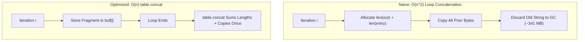

# String Concatenation in Lua: `..` vs `table.concat`

## Table of Contents

- [Introduction](#introduction)
- [Why Lua Strings Are Immutable and Interned](#why-lua-strings-are-immutable-and-interned)
- [The $O(n^2)$ Trap vs. $O(n)$ `table.concat`](#the-on2-trap-vs-on-tableconcat)
- [Naive vs. Buffered Walkthrough](#naive-vs-buffered-walkthrough)
  - [Naive: Loop Concatenation (`out = out .. entry`)](#naive-loop-concatenation-out--out--entry)
  - [Optimized: Reusable Array Buffer + `table.concat`](#optimized-reusable-array-buffer--tableconcat)
- [Pitfalls, Trade-offs, and When NOT to Use](#pitfalls-trade-offs-and-when-not-to-use)
- [Profiling Tips](#profiling-tips)
- [Summary](#summary)

---

## Introduction

Suppose you are writing a 5,000-line book. If every time you added a new sentence, you threw away the notebook, bought a larger one, and copied every previous sentence by hand before writing the new one, you would copy millions of words just to write 5,000 lines. Writing each sentence on an index card and binding them once at the end takes a fraction of the effort.

In Lua, concatenating strings inside a loop with `..` behaves exactly like recopying the entire notebook on every line.

---

## Why Lua Strings Are Immutable and Interned

In Lua 5.4 and LuaJIT, strings are **immutable** byte sequences: once created, a string's contents can never be modified in place. Short strings (up to 40 bytes in Lua 5.4) are also **interned** in a global string hash table so string equality (`a == b`) is an $O(1)$ pointer comparison.

Because strings cannot grow in place, every `out = out .. entry` inside a loop must:

1. Allocate a brand-new buffer of size `len(out) + len(entry)`.
2. Copy all bytes of `out` plus `entry` into the new buffer.
3. Hash the new string (for short strings) and register the intermediate string with the GC, even though it will be overwritten on the very next iteration.

---

## The $O(n^2)$ Trap vs. $O(n)$ `table.concat`

```text
Naive: out = out .. entry          Optimized: buf[i] = entry -> table.concat
iter 1: [1]                        buf[1] = entry_1
iter 2: [1][2]                     buf[2] = entry_2
iter 3: [1][2][3]                  ...
...                                buf[n] = entry_n
iter n: [1][2]...[n] (~341 MB!)    concat(buf, "", 1, n) -> 1 allocation!
```



`table.concat(buf, "", 1, count)` walks `buf[1..count]` once to sum the total byte length, allocates a single `luaL_Buffer` of the exact final size, and copies each fragment once in $O(n)$ time.

---

## Naive vs. Buffered Walkthrough

### Naive: Loop Concatenation (`out = out .. entry`)

In `lessons/StringConcat/naive.lua`, each iteration grows `out` by ~27 bytes while recopying all earlier bytes:

```lua
local out = ""
for i = 1, count do
    out = out .. "[tick=" .. i .. "] hit=25 crit=true\n"
end
return out
```

Over `5,000` iterations, `1 + 2 + ... + 5,000` copies produce `349,485.61 KB` (`~341.3 MB`) of temporary GC heap allocations.

### Optimized: Reusable Array Buffer + `table.concat`

In `lessons/StringConcat/optimized.lua`, `table.concat` is cached as a local and an optional `buf` array is reused across calls:

```lua
local concat = table.concat

function M.build_log(count, buf)
    if count <= 0 then
        return ""
    end

    buf = buf or {}
    for i = 1, count do
        buf[i] = "[tick=" .. i .. "] hit=25 crit=true\n"
    end
    return concat(buf, "", 1, count)
end
```

Passing explicit bounds `(buf, "", 1, count)` lets callers reuse `buf` across frames without clearing trailing elements from a longer previous call.

---

## Pitfalls, Trade-offs, and When NOT to Use

- **Stale Tail Elements on Reuse**: Calling `table.concat(buf)` without `1, count` will include leftover entries from a previous larger batch if you reuse `buf`.
- **Supported Types Only**: `table.concat` only accepts strings and numbers; passing `nil`, booleans, or tables inside `buf[1..count]` raises an error.
- **When NOT to Use**: Do not allocate a table just to join 2–4 strings in a single expression like `local msg = prefix .. name .. suffix`. Lua compiles chained `..` in one expression into a single `CONCAT` VM opcode, which is faster and allocates less than creating a temporary table.

---

## Profiling Tips

1. **Measure Allocation Delta**: Wrap your string builder in `collectgarbage("count")` before and after to spot hidden $O(n^2)$ intermediate strings.
2. **Inspect Bytecode**: Run `luac -l` to verify single-expression `a .. b .. c` emits one `CONCAT` instruction rather than a loop of allocations.

---

## Summary

Workload: `5,000`-entry combat log string on `Lua 5.4.7` (`lessons/StringConcat/Benchmark.md`).

| Metric | Naive (`out = out .. entry`) | Reusable Buffer + `table.concat` |
|---|---|---|
| Execution Time | `0.3441 s` | **`0.0010 s` (`342.37x` faster)** |
| GC Heap Allocated | `349,485.61 KB` (`~341.3 MB`) | **`281.17 KB` (`99.92%` less)** |
| Time Complexity | $O(n^2)$ byte copies | **$O(n)$ single-pass copy** |
| Best For | Never in loops; fine for 2–4 inline parts | Any loop building logs, CSV, JSON, HTML |
