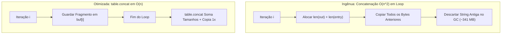

# Concatenação de Strings em Lua: `..` vs `table.concat`

## Sumário

- [Introdução](#introdução)
- [Por que Strings em Lua São Imutáveis e Internadas](#por-que-strings-em-lua-são-imutáveis-e-internadas)
- [A Armadilha $O(n^2)$ vs. `table.concat` em $O(n)$](#a-armadilha-on2-vs-tableconcat-em-on)
- [Passo a Passo: Loop Ingênuo vs. Buffer Reutilizável](#passo-a-passo-loop-ingênuo-vs-buffer-reutilizável)
  - [Ingênua: Concatenação no Loop (`out = out .. entry`)](#ingênua-concatenação-no-loop-out--out--entry)
  - [Otimizada: Buffer em Array + `table.concat`](#otimizada-buffer-em-array--tableconcat)
- [Armadilhas, Trade-offs e Quando NÃO Usar](#armadilhas-trade-offs-e-quando-não-usar)
- [Dicas de Profiling](#dicas-de-profiling)
- [Resumo](#resumo)

---

## Introdução

Imagine escrever um livro de 5.000 linhas. Se a cada nova frase você jogasse o caderno fora, comprasse um maior e copiasse à mão todas as frases anteriores antes de escrever a próxima, você copiaria milhões de palavras só para produzir 5.000 linhas. Escrever cada frase em um cartão e encadernar tudo de uma vez no final dá uma fração do trabalho.

Em Lua, concatenar strings dentro de um loop com `..` funciona exatamente como recopiar o caderno inteiro a cada linha.

---

## Por que Strings em Lua São Imutáveis e Internadas

Em Lua 5.4 e LuaJIT, strings são sequências de bytes **imutáveis**: após criadas, nunca podem ser alteradas no local. Strings curtas (até 40 bytes no Lua 5.4) também são **internadas** em uma tabela hash global para que comparações (`a == b`) ocorram em $O(1)$ por ponteiro.

Como strings não crescem no local, cada `out = out .. entry` dentro de um loop precisa:

1. Alocar um novo buffer de tamanho `len(out) + len(entry)`.
2. Copiar todos os bytes de `out` mais `entry` para o novo buffer.
3. Calcular hash (para strings curtas) e registrar a string intermediária no GC, mesmo que ela seja descartada na iteração seguinte.

---

## A Armadilha $O(n^2)$ vs. `table.concat` em $O(n)$

```text
Ingênua: out = out .. entry        Otimizada: buf[i] = entry -> table.concat
iter 1: [1]                        buf[1] = entry_1
iter 2: [1][2]                     buf[2] = entry_2
iter 3: [1][2][3]                  ...
...                                buf[n] = entry_n
iter n: [1][2]...[n] (~341 MB!)    concat(buf, "", 1, n) -> 1 alocação!
```



`table.concat(buf, "", 1, count)` percorre `buf[1..count]` uma vez para somar o tamanho total em bytes, aloca um único `luaL_Buffer` do tamanho exato e copia cada fragmento uma única vez em tempo $O(n)$.

---

## Passo a Passo: Loop Ingênuo vs. Buffer Reutilizável

### Ingênua: Concatenação no Loop (`out = out .. entry`)

Em `lessons/StringConcat/naive.lua`, cada iteração aumenta `out` em ~27 bytes recopiando todos os anteriores:

```lua
local out = ""
for i = 1, count do
    out = out .. "[tick=" .. i .. "] hit=25 crit=true\n"
end
return out
```

Ao longo de `5.000` iterações, `1 + 2 + ... + 5.000` cópias geram `349,485.61 KB` (`~341.3 MB`) de alocações temporárias na heap do GC.

### Otimizada: Buffer em Array + `table.concat`

Em `lessons/StringConcat/optimized.lua`, `table.concat` fica em cache local e um array `buf` opcional é reutilizado entre chamadas:

```lua
local concat = table.concat

function M.build_log(count, buf)
    if count <= 0 then
        return ""
    end

    buf = buf or {}
    for i = 1, count do
        buf[i] = "[tick=" .. i .. "] hit=25 crit=true\n"
    end
    return concat(buf, "", 1, count)
end
```

Passar limites explícitos `(buf, "", 1, count)` permite reutilizar `buf` entre frames sem limpar entradas sobrando de uma chamada anterior maior.

---

## Armadilhas, Trade-offs e Quando NÃO Usar

- **Sobras no Final ao Reutilizar**: Chamar `table.concat(buf)` sem `1, count` inclui elementos antigos de um lote anterior maior se `buf` for reutilizado.
- **Apenas Tipos Suportados**: `table.concat` só aceita strings e números; `nil`, booleanos ou tabelas dentro de `buf[1..count]` disparam erro.
- **Quando NÃO Usar**: Não crie uma tabela só para juntar 2 a 4 strings em uma única expressão como `local msg = prefix .. name .. suffix`. Lua compila `..` encadeado em uma expressão para um único opcode `CONCAT`, que é mais rápido e aloca menos que uma tabela temporária.

---

## Dicas de Profiling

1. **Meça o Delta de Alocação**: Envolva o gerador de strings com `collectgarbage("count")` antes e depois para flagrar strings intermediárias $O(n^2)$.
2. **Inspecione o Bytecode**: Rode `luac -l` para confirmar que `a .. b .. c` em uma linha gera apenas uma instrução `CONCAT`.

---

## Resumo

Carga: log de combate com `5.000` entradas no `Lua 5.4.7` (`lessons/StringConcat/Benchmark.md`).

| Métrica | Ingênua (`out = out .. entry`) | Buffer Reutilizável + `table.concat` |
|---|---|---|
| Tempo de Execução | `0.3441 s` | **`0.0010 s` (`342.37x` mais rápido)** |
| Heap GC Alocado | `349,485.61 KB` (`~341.3 MB`) | **`281.17 KB` (`99.92%` menor)** |
| Complexidade | $O(n^2)$ cópias de bytes | **$O(n)$ em passada única** |
| Melhor Para | Nunca em loops; ok para 2–4 partes inline | Qualquer loop gerando logs, CSV, JSON |
