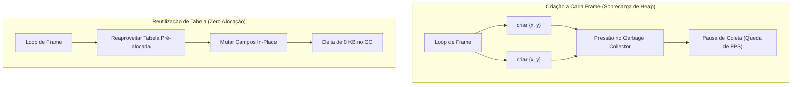

# Reutilização de Tabelas vs Criação por Frame

## Sumário

- [Introdução](#introdução)
- [O Custo de Alocar Tabelas em Lua](#o-custo-de-alocar-tabelas-em-lua)
- [Coleta de Lixo em Lua e Engasgos de Frame](#coleta-de-lixo-em-lua-e-engasgos-de-frame)
- [Padrões de Reutilização de Tabelas](#padrões-de-reutilização-de-tabelas)
  - [Padrão 1: Mutação no Local (In-Place)](#padrão-1-mutação-no-local-in-place)
  - [Padrão 2: Buffer de Rascunho (Scratch Table)](#padrão-2-buffer-de-rascunho-scratch-table)
  - [Padrão 3: Parâmetro de Destino (Out)](#padrão-3-parâmetro-de-destino-out)
- [Armadilhas e Cuidados](#armadilhas-e-cuidados)
- [Resumo](#resumo)

---

## Introdução

Em loops de jogos desenvolvidos em Lua (como Love2D, Defold ou engines proprietárias), a criação de tabelas é a principal fonte de alocação de memória. Códigos como `return { x = a.x + b.x, y = a.y + b.y }` dentro de loops de física geram milhares de tabelas temporárias por quadro, disparando coletas de lixo que derrubam a taxa de quadros abaixo de 60 FPS.

---

## O Custo de Alocar Tabelas em Lua

Cada tabela criada em Lua é uma estrutura C alocada na heap (`Table` na implementação padrão):

1. **Cabeçalho de Memória**: Contém ponteiros para parte de array, hash part, metatabela e flags do GC (~40 a 56 bytes mínimos).
2. **Nós da Hash**: Chaves como `x` e `y` alocam entradas na tabela hash (`Node`), além do cálculo de hash de strings.
3. **Rastreamento do GC**: Cada nova tabela precisa ser registrada nas listas de controle do coletor de lixo.



---

## Coleta de Lixo em Lua e Engasgos de Frame

Lua utiliza um coletor incremental do tipo mark-and-sweep. Quando o consumo de memória sobe abruptamente, o GC acelera seus ciclos. Se o volume de alocação superar o ritmo do coletor, ocorrem pausas perceptíveis de 2 a 10 milissegundos, estourando o limite de 16.6 ms por quadro.

---

## Padrões de Reutilização de Tabelas

### Padrão 1: Mutação no Local (In-Place)
Ao atualizar entidades persistentes, altere os campos diretamente em vez de criar uma nova tabela:
```lua
function integrate_inplace(pos, vel, dt)
    pos.x = pos.x + (vel.x * dt)
    pos.y = pos.y + (vel.y * dt)
    return pos
end
```

### Padrão 2: Buffer de Rascunho (Scratch Table)
Para cálculos intermediários que são lidos imediatamente e descartados:
```lua
local scratch = { x = 0, y = 0 }

function get_screen_bounds(pos, offset)
    scratch.x = pos.x + offset.x
    scratch.y = pos.y + offset.y
    return scratch -- Use imediatamente; não guarde a referência!
end
```

### Padrão 3: Parâmetro de Destino (Out)
Permita que o chamador passe uma tabela de destino pré-alocada:
```lua
function add(a, b, out)
    out = out or scratch
    out.x = a.x + b.x
    out.y = a.y + b.y
    return out
end
```

---

## Armadilhas e Cuidados

- **Erros de Aliasing**: Armazenar referências de tabelas scratch entre frames corrompe dados quando outra função reutiliza a mesma tabela.
- **Regra de Ouro**: Tabelas scratch devem ser consumidas imediatamente na pilha atual. Para estados persistentes de entidades, passe tabelas dedicadas.

---

## Resumo

| Métrica | Criação por Frame | Reutilização / In-Place |
|---|---|---|
| Alocações na Heap | 1+ por operação | **0** |
| Delta de Memória GC (50k ops) | ~10 MB | **0 KB** |
| Latência de Execução | ~570 ns/op | **~100 ns/op (5.7x mais rápido)** |
| Picos de Coleta de Lixo | Frequentes | Inexistentes |
